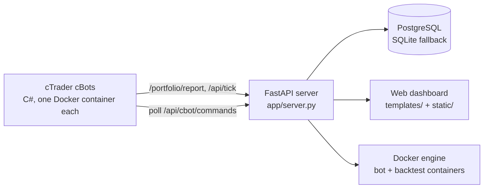

# Architecture

How the pieces of AgentFxTrading fit together. For setup see [deployment.md](deployment.md); for settings see
[configuration.md](configuration.md); for what each strategy trades see [strategies.md](strategies.md).

## Overview



| Component | Technology | Responsibility |
| :--- | :--- | :--- |
| cBots (`cBot/*.cs`) | C# / cTrader, run headless by `ghcr.io/spotware/ctrader-console` | Detect setups on their own rules, size and execute trades, manage open positions |
| Server (`app/`) | Python / FastAPI / uvicorn | Position tracking, dashboard, bot management, backtests |
| Database | PostgreSQL 17 in production, SQLite `portfolio.db` fallback | Positions, trade history, bot configs, accounts, pause flags, backtest jobs |
| Dashboard | Jinja2 template + static JS/CSS | Monitoring, leaderboard, Docker bot management, Setup Instances, Backtest, Ledger, logs |

The server must run as a **single uvicorn worker** (`uvicorn app.server:app`, no `--workers`): the dashboard →
cBot command queue (`app/bot_commands.py`) and several caches live in process memory.

## What the cBots talk to

The bots trade on their own rules; the server never makes a trading decision.

| Endpoint | Purpose |
| :--- | :--- |
| `POST /portfolio/report` | Position open / close lifecycle, retried by the bot until the server answers |
| `POST /api/tick` | Telemetry: bid/ask, broker P&L and SL/TP per position, the last bar handled |
| `GET /api/cbot/commands`, `POST /api/cbot/commands/{id}/result` | Dashboard commands (close, close & stop, pause) polled every `CommandPollMs` |

The server cannot reach a cBot directly, which is why commands are polled. Every URL is derived from the bot's
`--ApiUrl` (`http://127.0.0.1:8000/trade`) by replacing or stripping its `/trade` suffix; the server has no `/trade`
route.

These calls reach `127.0.0.1:8000` directly, not through nginx, so the dashboard login (`app/auth.py`) does not
apply to them.

## HTTP API

FastAPI generates the full, current reference: open **`http://127.0.0.1:8000/docs`** (Swagger UI) or
**`/redoc`** on a running server. The route groups are:

| Group | Prefix | Module |
| :--- | :--- | :--- |
| Bot reporting | `/portfolio/report`, `/portfolio/status`, `/api/tick`, `/api/telemetry_tick`, `/api/dashboard/accounts` | `app/portfolio_api.py` |
| Dashboard pages | `/`, `/dashboard`, `/demo[/dashboard]`, `/real[/dashboard]`, `/live[/dashboard]` | `app/dashboard.py` |
| Dashboard data | `/api/dashboard/*`, `/api/leaderboard`, `WS /ws/dashboard` | `app/dashboard.py` |
| Docker bot management | `/api/bots/*`, `/api/positions/{id}/close`, `/api/bot-commands/*`, `/api/watchdog/status` | `app/dashboard.py` |
| Setup Instances | `/api/setup/*`, `/api/ctrader-accounts/*` | `app/dashboard.py` |
| Ledger | `/api/ledger`, `/api/ledger/movements` | `app/ledger_api.py` (logic in `app/ledger.py`) |
| Backtests | `/api/backtests/*` | `app/backtest_api.py` |

Most dashboard data routes accept `account_id=demo|live|all|<id>`; see `/docs` for parameters. New endpoints go in
an `APIRouter` module, not in `app/server.py` (see [AGENTS.md](../AGENTS.md)).

## Background tasks

Started from the FastAPI lifespan in `app/server.py`:

- **cBot watchdog** (`app/cbot_watchdog.py`): every 60 s checks container logs for login failures and broker
  disconnects, and restarts a bot whose ticks keep flowing while the last bar it handled stops advancing: 40 min
  on an M15 chart, one bar plus 25 min on a slower one (85 min for Crypto Donchian on H1). Restarts are
  rate-limited with backoff. Status: `GET /api/watchdog/status`.
- **Backtest worker** (`app/backtest_worker.py`): runs queued Backtest-page jobs in `bt-<id>` containers, several
  at once (setting on the page, else `BACKTEST_MAX_PARALLEL`). Reports are kept in `webui_data/backtests/`.

## Dashboard modes

`/demo/dashboard` and `/real/dashboard` show only demo or only live accounts. `/` and `/dashboard` redirect to the
mode used last, remembered by the `agentfx_trade_mode` cookie and `webui_data/trade_mode.json`. Accounts are the
cTrader accounts created on the Setup Instances screen; a cBot tags its trades with `--AccountLabel`.

## Logging

- `logs/agent_YYYY-MM-DD.log`: server log, one file per day (GMT+7 date), 14 files kept.
- The same log stream is pushed to the dashboard over `WS /ws/dashboard`.
- cBot output: `docker logs <container>`.

## Project structure

```
AgentFxTrading/
├── app/                         FastAPI server (Python)
│   ├── server.py                app entry point: logging, lifespan, routers
│   ├── auth.py                  dashboard login (DASHBOARD_USERNAME / DASHBOARD_PASSWORD), session middleware
│   ├── portfolio_api.py         bot reporting routes (/portfolio/report, /api/tick)
│   ├── dashboard.py             dashboard pages and APIs (APIRouter)
│   ├── backtest_*.py            Backtest page: API, container specs, params, worker, reports, job store
│   ├── cbot_presets.py          strategy × symbol presets: source of truth for docker-instances.md
│   ├── cbot_watchdog.py         container health checks and auto-restart
│   ├── docker_manager.py        Docker bot configs and container control
│   ├── portfolio.py             position tracking
│   ├── leaderboard.py           bot performance ranking
│   ├── ledger.py, ledger_api.py account ledger: deposits / withdrawals, expected vs broker balance
│   ├── accounts.py, ctrader_accounts.py   dashboard accounts, cTrader logins
│   ├── bot_commands.py, bot_controls.py   dashboard → cBot commands, per-bot pause
│   └── db.py                    PostgreSQL / SQLite layer
├── cBot/                        cTrader cBots (C#), one file per bot
│   ├── GotobiBot.cs             Gotobi Tokyo fix
│   └── CryptoDonchianBot.cs     Crypto Donchian H4
├── templates/dashboard.html     dashboard page
├── static/                      dashboard JS (js/), CSS (css/), favicon
├── scripts/                     VPS installer, PostgreSQL backup, SQLite → PostgreSQL migration
├── docs/                        reference docs, instance catalog, screenshots
├── research/                    offline strategy research, own venv; see research/README.md
├── tests/                       pytest suite for the app and the cBot sources
├── .env.example                 environment template
└── requirements.txt             server dependencies
```

Runtime directories created next to the code and ignored by git: `logs/`, `data/`, `webui_data/`, `backups/`,
`portfolio.db*`.
