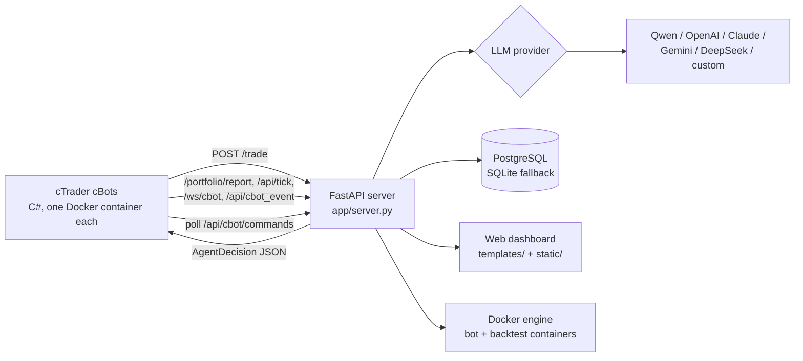

# Architecture

How the pieces of AgentFxTrading fit together. For setup see [deployment.md](deployment.md); for settings see
[configuration.md](configuration.md); for what each strategy trades see [strategies.md](strategies.md).

## Overview



| Component | Technology | Responsibility |
| :--- | :--- | :--- |
| cBots (`cBot/*.cs`) | C# / cTrader, run headless by `ghcr.io/spotware/ctrader-console` | Compute indicators, detect setups, size and execute trades, manage open positions |
| Server (`app/`) | Python / FastAPI / uvicorn | Gates, portfolio risk checks, LLM calls, position tracking, dashboard and bot management |
| Database | PostgreSQL 17 in production, SQLite `portfolio.db` fallback | Positions, trade history, bot configs, accounts, risk limits, backtest jobs, news assessments |
| LLM | Any supported provider (see [configuration.md](configuration.md#llm-provider)) | Entry / exit decision for AI-gated bots, news assessment |
| Dashboard | Jinja2 template + static JS/CSS | Monitoring, Docker bot management, Setup Instances, Backtest, Risk Limits, News |

The server must run as a **single uvicorn worker** (`uvicorn app.server:app`, no `--workers`): the dashboard →
cBot command queue (`app/bot_commands.py`) and several caches live in process memory.

## Decision flow (`POST /trade`)

1. An AI-gated cBot (TMS+ORB, Judas Sweep, FlowRSI) sends a `MarketSnapshot`: bars, indicator state, session,
   open position, multi-timeframe context. The request model is `MarketSnapshot` in `app/trade_models.py`.
2. The server runs deterministic gates first (`app/trade_gates.py`). When there is no qualifying setup it returns `HOLD` without calling
   the LLM, which is where most of the token savings come from.
3. For entries, `PortfolioManager.check_risk` (`app/portfolio.py`) applies portfolio limits, per-bot pause
   (`app/bot_controls.py`) and the daily loss limits (`app/risk_limits.py`).
4. The LLM is called with a strategy-specific prompt (`build_system_prompt`, `build_judas_sweep_system_prompt`,
   `build_user_prompt` in `app/trade_prompts.py`). `/trade` (in `app/server.py`) has its own timeout, retry and deadline settings because a
   cBot is waiting on the answer.
5. The response is an `AgentDecision`: `action` (`BUY`, `SELL`, `HOLD`, `CLOSE_ALL`, `ADJUST`), `volume_lots`,
   `sl_pips` / `tp_pips`, `new_sl_price` / `new_tp_price`, `confidence`, `reason`.

The cBot stays in charge of execution: it sizes positions from its own risk parameters and, with ATR-based stops
enabled, computes SL/TP from ATR within its min/max guardrails rather than taking the LLM's pips at face value.

The rule-based bots (Gotobi, Crypto Donchian) do not ask for decisions; they only report positions and telemetry
and poll for dashboard commands. The Judas Sweep bot can also call an LLM directly (`UseDirectAiApi=true`),
bypassing the server's gates.

## What the cBots talk to

| Endpoint | Used by | Purpose |
| :--- | :--- | :--- |
| `POST /trade` | TMS+ORB, Judas (server mode), FlowRSI | Decision request |
| `POST /portfolio/report` | all | Position open / close lifecycle |
| `POST /api/tick` | all | Telemetry over HTTP |
| `WS /ws/cbot` | TMS+ORB, Judas | Tick stream: bid/ask and broker P&L (`TickStreamMs`, 0 = off) |
| `POST /api/cbot_event` | TMS+ORB, Judas | Guardrail blocks and other bot events |
| `GET /api/cbot/commands`, `POST /api/cbot/commands/{id}/result` | all | Dashboard commands (close, close & stop, pause) polled every `CommandPollMs` |
| `GET /api/news/calendar` | Judas | News filter calendar |

The server cannot reach a cBot directly, which is why commands are polled.

## HTTP API

FastAPI generates the full, current reference: open **`http://127.0.0.1:8000/docs`** (Swagger UI) or
**`/redoc`** on a running server. The route groups are:

| Group | Prefix | Module |
| :--- | :--- | :--- |
| Bot decisions | `/trade` | `app/server.py` |
| Bot reporting | `/portfolio/*`, `/api/tick`, `/api/telemetry_tick`, `/api/cbot_event`, `/api/dashboard/accounts`, `/api/tms/cross-locks` | `app/portfolio_api.py` |
| Dashboard pages | `/`, `/dashboard`, `/demo[/dashboard]`, `/real[/dashboard]`, `/live[/dashboard]` | `app/dashboard.py` |
| Dashboard data | `/api/dashboard/*`, `/api/leaderboard`, `WS /ws/dashboard` | `app/dashboard.py` |
| Docker bot management | `/api/bots/*`, `/api/positions/{id}/close`, `/api/bot-commands/*`, `/api/watchdog/status` | `app/dashboard.py` |
| Setup Instances | `/api/setup/*`, `/api/ctrader-accounts/*` | `app/dashboard.py` |
| Risk limits | `/api/risk-limits` | `app/dashboard.py` |
| News | `/api/news/*` | `app/dashboard.py` |
| Backtests | `/api/backtests/*` | `app/backtest_api.py` |

Most dashboard data routes accept `account_id=demo|live|all|<id>`; see `/docs` for parameters. New endpoints go in
an `APIRouter` module, not in `app/server.py` (see [AGENTS.md](../AGENTS.md)).

## Background tasks

Started from the FastAPI lifespan in `app/server.py`:

- **cBot watchdog** (`app/cbot_watchdog.py`): every 60 s checks container logs for login failures and broker
  disconnects, and restarts a bot whose session is open but whose bar feed went quiet (default 40 min). Restarts
  are rate-limited with backoff. Status: `GET /api/watchdog/status`.
- **Backtest worker** (`app/backtest_worker.py`): runs queued Backtest-page jobs in `bt-<id>` containers, several
  at once (setting on the page, else `BACKTEST_MAX_PARALLEL`). Reports are kept in `webui_data/backtests/`.

## Dashboard modes

`/demo/dashboard` and `/real/dashboard` show only demo or only live accounts. `/` and `/dashboard` redirect to the
mode used last, remembered by the `agentfx_trade_mode` cookie and `webui_data/trade_mode.json`. Accounts and their
type come from `DASHBOARD_ACCOUNTS` and the cTrader accounts added on the Setup Instances screen; a cBot tags its
trades with `--AccountLabel`.

## Logging

- `logs/agent_YYYY-MM-DD.log`: server and agent reasoning log, one file per day (GMT+7 date), 14 files kept.
- The same log stream is pushed to the dashboard over `WS /ws/dashboard`.
- cBot output: `docker logs <container>`.

## Project structure

```
AgentFxTrading/
├── app/                         FastAPI server (Python)
│   ├── server.py                app entry point, /trade, prompts, portfolio reporting
│   ├── dashboard.py             dashboard pages and APIs (APIRouter)
│   ├── backtest_*.py            Backtest page: API, container specs, params, worker, reports, job store
│   ├── cbot_presets.py          strategy × symbol presets: source of truth for docker-instances.md
│   ├── cbot_watchdog.py         container health checks and auto-restart
│   ├── docker_manager.py        Docker bot configs and container control
│   ├── portfolio.py             position tracking and portfolio risk checks
│   ├── risk_limits.py           daily loss limits (account / strategy / container)
│   ├── llm_client.py            LLM provider abstraction
│   ├── news_service.py          ForexFactory calendar and AI news assessment
│   ├── leaderboard.py           bot performance ranking
│   ├── accounts.py, ctrader_accounts.py   dashboard accounts, cTrader logins
│   ├── bot_commands.py, bot_controls.py   dashboard → cBot commands, per-bot pause
│   └── db.py                    PostgreSQL / SQLite layer
├── cBot/                        cTrader cBots (C#), one file per bot
│   ├── AiAgentBot.cs            TMS + ORB
│   ├── AsianRangeJudasSweepBot.cs   Asian Range Judas Sweep
│   ├── FlowRsiBot.cs            FlowRSI
│   ├── GotobiBot.cs             Gotobi Tokyo fix
│   └── CryptoDonchianBot.cs     Crypto Donchian H4
├── templates/dashboard.html     dashboard page
├── static/                      dashboard JS (js/), CSS (css/), favicon
├── scripts/                     VPS installer, PostgreSQL backup, SQLite → PostgreSQL migration, maintenance
├── docs/                        reference docs, instance catalog, screenshots
├── research/                    offline strategy research, own venv; see research/README.md
├── tests/                       pytest suite for the app and the cBot sources
├── .env.example                 environment template
└── requirements.txt             server dependencies
```

Runtime directories created next to the code and ignored by git: `logs/`, `data/`, `webui_data/`, `backups/`,
`portfolio.db*`.
